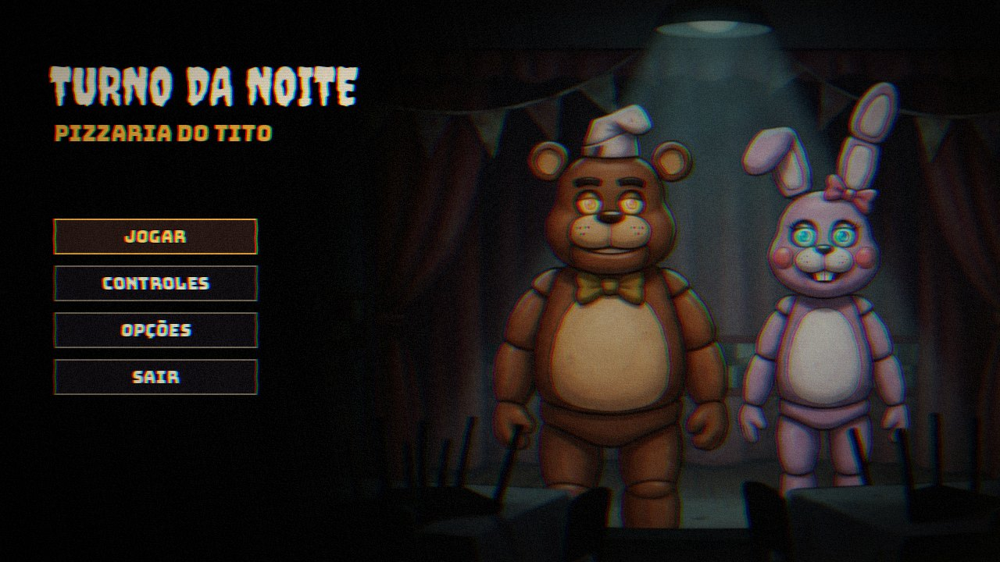
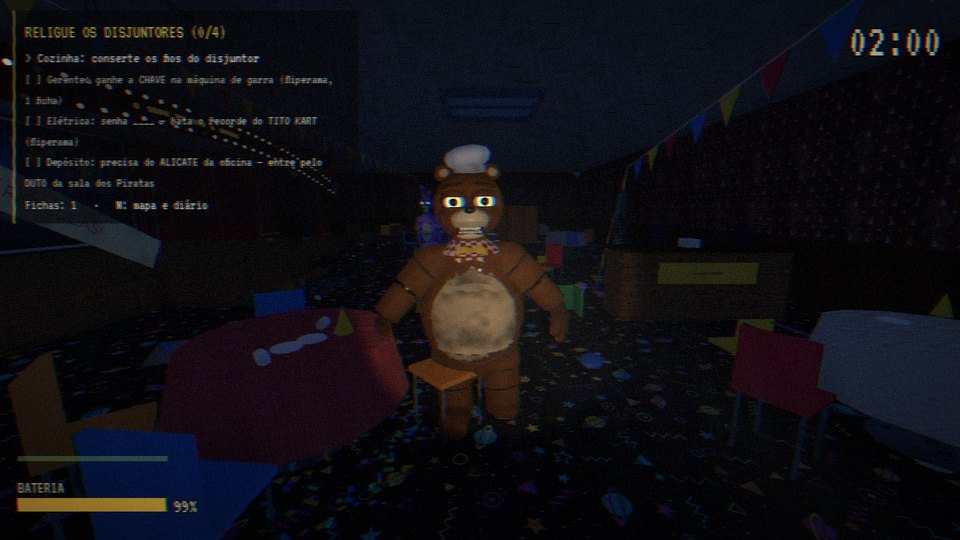
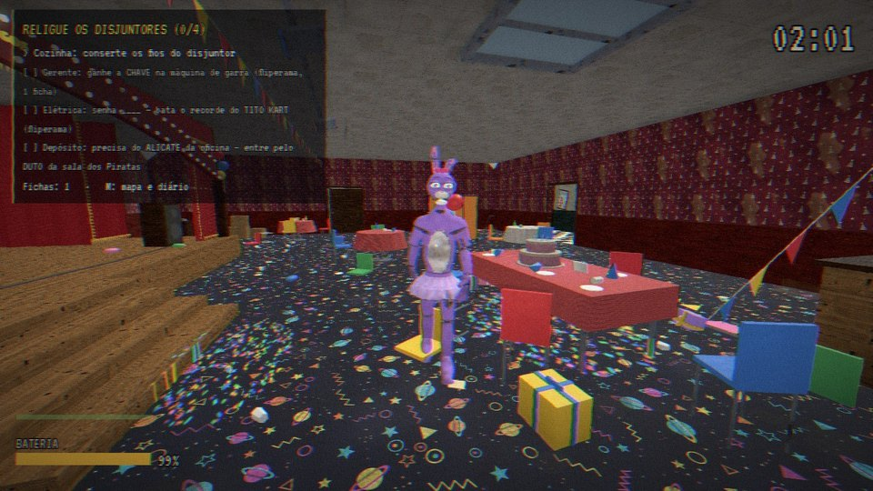
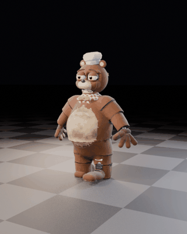
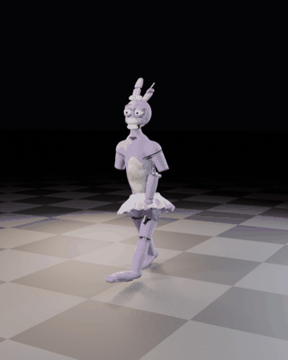
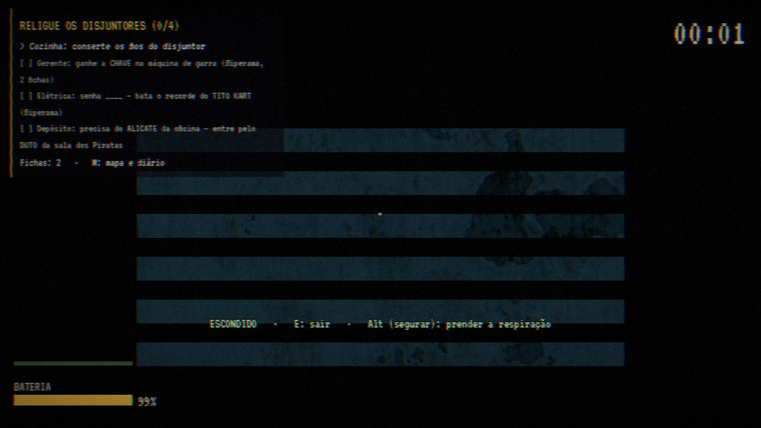
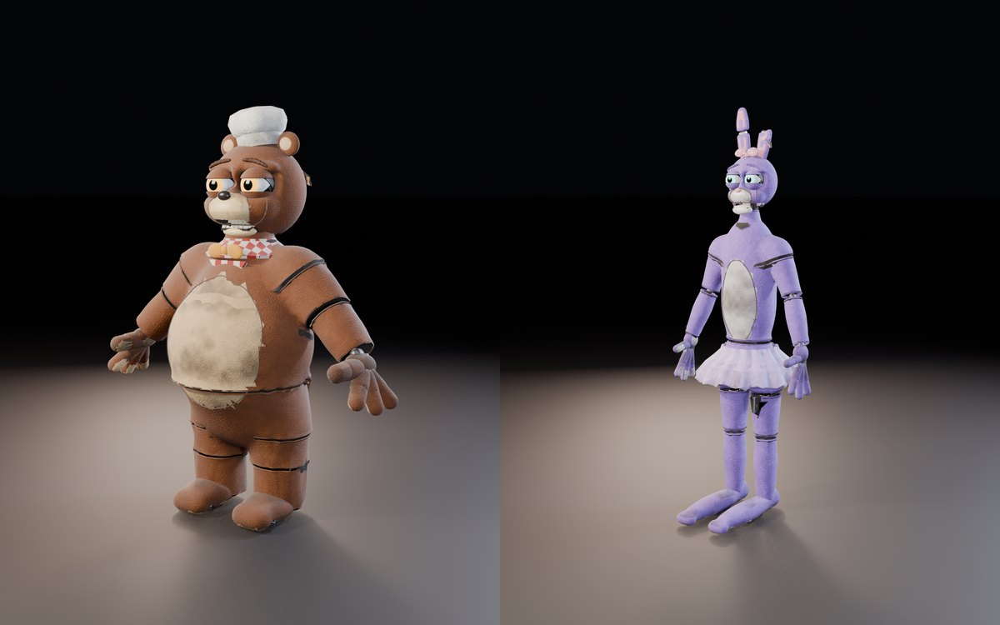

# Turno da Noite: Pizzaria do Tito

Um jogo de terror em primeira pessoa feito para a disciplina de Computação Gráfica, usando **Godot 4.7.2** e **Blender 5.3**.

Você é o novo vigia noturno da Pizzaria do Tito. Logo no começo do turno a energia cai, e a pizzaria, que de dia é cheia de criança, à noite fica bem menos simpática. Para chegar vivo às 6h é preciso religar os quatro disjuntores, ligar o gerador e se trancar na sala de segurança. O problema é que os dois mascotes do palco não ficam parados.

## Baixar e jogar

Os executáveis estão na página de [**Releases**](../../releases/latest).

- **Windows:** baixe o `TurnoDaNoite_Windows.exe` e dê dois cliques. É um arquivo só, não precisa instalar nada. Se aparecer o aviso "O Windows protegeu o computador", clique em *Mais informações* e depois em *Executar assim mesmo*.
- **Linux:** baixe o `TurnoDaNoite_Linux.zip`, descompacte, abra um terminal na pasta e rode `sh rodar_linux.sh`.

Se a tela ficar preta ou o jogo fechar ao abrir (placa de vídeo mais antiga), use o modo de compatibilidade: `TurnoDaNoite.exe --rendering-driver opengl3` no Windows ou `sh rodar_linux.sh --rendering-driver opengl3` no Linux.

## Os animatrônicos

  
  

**Tito**, o urso pizzaiolo, é pesado e lento, mas só anda quando ninguém está olhando. Com a lanterna nele, ele congela no lugar. É só desviar o olhar que ele volta a andar, e quando você olha de novo a cabeça dele já está virada na sua direção.

**Pipoca**, a coelha, é rápida e nervosa. Ela patrulha a pizzaria, vai atrás de qualquer barulho e corre quando vê você. Se a lanterna ficar nela por alguns segundos, ela trava e volta para o palco.

  
  

## Como sobreviver

- A lanterna é sua melhor amiga, mas a bateria acaba. Tem pilhas espalhadas pelo mapa.
- Correr faz barulho, e a Pipoca escuta. Agachado quase não faz.
- Dá para se esconder em armários, embaixo de mesas, atrás de cortinas e nas cabines do banheiro. Se ela chegar perto, prenda a respiração.
- O caminho até o gerador passa por portas trancadas, uma senha escondida pela pizzaria e as máquinas do fliperama. O painel no canto da tela sempre mostra o próximo passo, e o mapa marca onde ir.

### Controles

| Tecla | Ação |
|---|---|
| W A S D / Shift | andar / correr |
| Mouse | olhar |
| F / R | lanterna / sacudir a lanterna quando ela está fraca |
| E | interagir (portas, disjuntores, itens, esconderijos, máquinas) |
| Ctrl / Alt | agachar / prender a respiração |
| G | arremessar uma lata para distrair |
| Tab / M | inventário / mapa e anotações |
| ESC / F11 | pausa / tela cheia |

Para testar à vontade, **Ctrl+Shift+D** durante a partida liga as teclas de depuração (F9 mostra todas). Com **Shift+F5**, os animatrônicos passam a ignorar o jogador, o que é bom para ver as animações de perto.

## Como foi feito

Todo o 3D foi feito no Blender: o prédio, os móveis, os disjuntores, as máquinas do fliperama e os animatrônicos, com texturas e iluminação pensadas para a pizzaria parecer alegre de dia e sinistra no escuro.

Os animatrônicos começam pelo **endoesqueleto**, o esqueleto mecânico de metal com todas as articulações. Por cima dele vem a fantasia de pelúcia, modelada como um volume único e depois cortada nas juntas, como uma fantasia de verdade. Cada pedaço fica preso a um osso, e pelas frestas dá para ver o metal trabalhando. As texturas misturam uma pelúcia de banco livre com um pelo curto feito no próprio Blender e "assado" num mapa de relevo.

As animações (parado, andar, perseguir, procurar, jumpscare e, na Pipoca, atordoada) foram feitas em cima do rig do endoesqueleto. As pernas usam cinemática inversa para os pés ficarem plantados no chão, e o resto do corpo se mexe aos trancos, como os servo-motores de um animatrônico. No jogo, a velocidade da animação acompanha a velocidade real do personagem, e a cabeça e os olhos seguem o jogador por código.

## Rodando pelo código-fonte

1. Instale o [Godot 4.7.2](https://godotengine.org/download).
2. Abra o arquivo `godot/project.godot`. Na primeira vez ele demora alguns minutos importando tudo.
3. Aperte **F5**.

| Pasta | O que tem |
|---|---|
| `godot/` | o projeto do jogo (cenas, scripts e assets) |
| `godot/scripts/` | `jogador.gd` (o vigia), `tito.gd` e `pipoca.gd` (a IA), `animatronico.gd` (o que os dois têm em comum), `jogo.gd` (relógio, vitória e derrota) |
| `blender/` | os arquivos `.blend` do cenário e dos personagens |

Os `.blend` com as texturas empacotadas, que abrem em qualquer computador, estão no arquivo `TurnoDaNoite_Blender_texturas_empacotadas.zip` das Releases.

## Créditos

Feito por **Francisco** e **Vinícius**.

Texturas da [ambientCG](https://ambientcg.com) (CC0), fontes do Google Fonts (OFL) e efeitos sonoros do [elevenlabs.io](https://elevenlabs.io). A lista completa está em [docs/CREDITOS.md](docs/CREDITOS.md).
